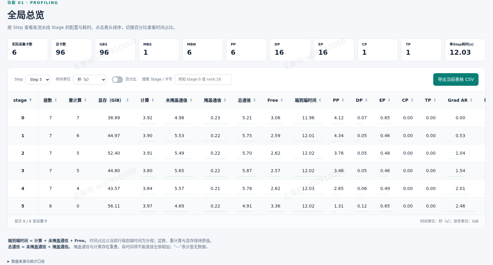
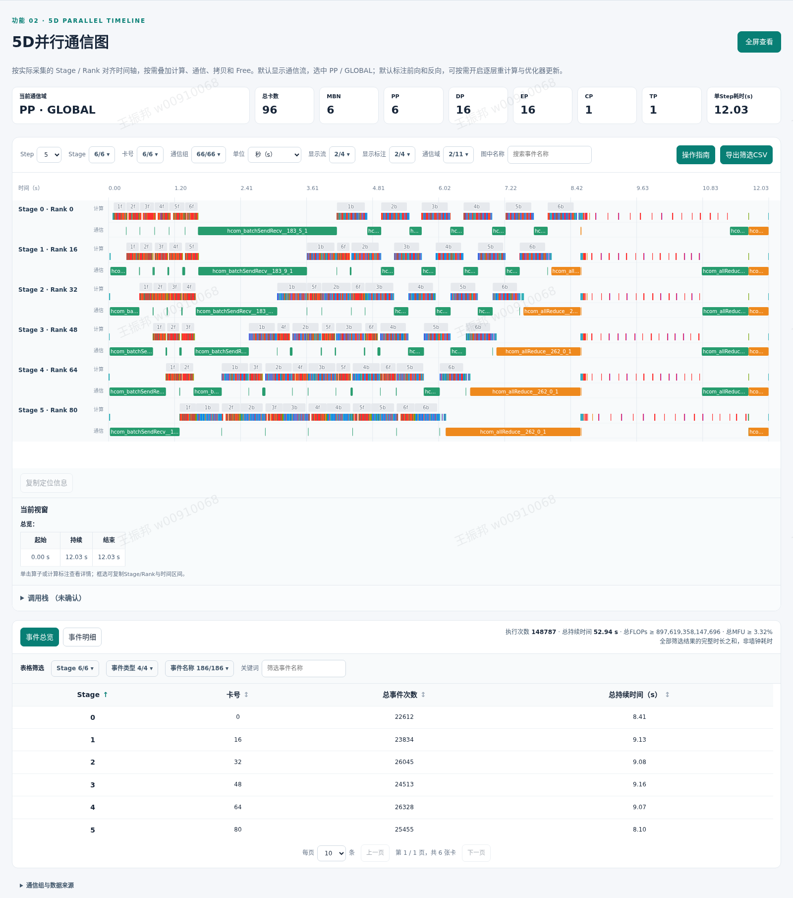

# WZB Profiling Analysis Skills

将已导出的 Ascend / MindSpore / PyTorch TEXT profiling 生成一份离线交互 HTML，包含「全局总览」和「5D并行通信图」两个功能。无需将 profiling 下载到本地，也无需启动 msinsight 服务；在数据所在机器运行脚本，打开生成的 HTML 即可查看。

数据识别、解析、统计、校验、页面渲染和最终拼装全部由随附 Python 脚本完成。Agent 首次使用只需执行命令、读取结果并提供报告链接；后续需要解释异常、改进功能或 debug 时，再使用 Agent 分析和修改源码。

HTML默认使用无损列式压缩与共享字典，保留算子、精确时间、I/O、调用栈及通信详情；加载后释放压缩文本，降低浏览器内存。已有报告可用`--render-only`重新生成。[优化方式、实测及复现命令](references/html-performance.md)。

## 功能一：全局总览

先了解一个 Step 的整体时间分布，再比较不同 Stage 的差异。



- **配置与规模**：查看实际采集卡数、总卡数、GBS、MBS、MBN、PP / DP / EP / CP / TP 和单 Step 耗时。
- **时间分解**：按 Stage / 实采卡展示计算、未掩盖通信、掩盖通信、总通信、Free 和端到端时间。
- **并行通信分解**：展示 PP / DP / EP / CP / TP、梯度相关 AllReduce、bubble 及扣除 bubble 的有效耗时；有采集证据时展示层数、重计算和显存。
- **时间与百分比切换**：默认秒，可切换毫秒、微秒；百分比以本行端到端时间为分母。
- **比较与导出**：支持表头排序、搜索、行列悬停高亮和 CSV 导出。

适合回答：哪个 Stage 较慢？未掩盖通信占比有多高？各 Stage 的计算和通信是否均衡？

## 功能二：5D并行通信图

在统一时间轴上查看每个 Stage / Rank 的执行过程，将总览中的差异定位到时间区间和具体算子。



- **多流对齐**：计算、通信、拷贝、Free 分行展示，便于观察重叠关系；预览图开启了计算和通信流，通信域为默认的 PP + GLOBAL。
- **通信域筛选**：支持 PP、DP、EP、CP、TP、GLOBAL，以及 TP-Extend-EP、DP-Modulo-EP、DP-With-CP、DP-With-CP-Modulo-EP；无法确认的事件保留为「未确认」。
- **级联复选**：按 Stage、卡号、通信组、显示流、调度标注和通信域组合查看；支持名称搜索。
- **调度过程**：按可验证证据显示前向 f、反向 b、逐层重计算 r 和 Adam 优化器更新 opt；查看通信方向及通信组成员。
- **交互定位**：鼠标移入图后用 W / S 聚焦缩放、A / D 平移；普通框选筛选事件，Ctrl + 框选重组所选泳道与时间窗，Esc 恢复，支持全屏查看。
- **算子详情**：悬停查看信息，单击后详情浮窗固定跟随色块，点击空白关闭。计算算子展示输入 / 输出 shape、dtype、format，以及有证据的 FLOPs / MFU；通信算子展示收发 Rank、通信量、传输 / 等待时间和带宽。
- **统计与证据**：提供事件总览、事件明细、筛选、排序、分页和 CSV；框选或点击计算范围块可查看 FLOPs / MFU 汇总，支持复制时间区间和展开已有 Python 调用栈。

适合回答：这段等待发生在哪张卡？计算与哪些通信重叠？这个算子的输入输出是什么？某段区间包含哪些事件？

## 如何使用

需要 Linux、Python 3.10+ 和 `ijson`。将 `SKILL_DIR` 设置为本目录的实际路径：

```bash
python3 -m pip install -r "$SKILL_DIR/scripts/requirements.txt"
python3 "$SKILL_DIR/scripts/run_analysis.py" \
  --profiling "/path/to/profiling-or-job" \
  --output-dir "/path/to/analysis-result"
```

生成结果：

| 文件 | 用途 |
| --- | --- |
| `analysis-result/report.html` | 两个功能合并的离线交互报告 |
| `analysis-result/workflow.json` | 执行状态、统计、输出路径和耗时 |
| `analysis-result/summary.md` | 结果摘要及数据限制 |
| `analysis-result/overview/`、`parallel/` | 两个功能各自的数据、CSV、页面和缓存 |

输入支持任务目录、profiling 目录、单卡采集目录或 `ASCEND_PROFILER_OUTPUT`。首次完整分析默认一次扫描，并按CPU、可用内存和实采卡数自动选择并发（最多8），也可以用`--workers N`手动指定。首次扫描的耗时取决于数据规模；已有结果可用 `--render-only` 重生成页面，无需重新解析。用现代浏览器打开 HTML，无需网络资源。

## 数据与复现边界

截图来自本技能对真实 profiling 生成的报告，保留正式样式和水印；不是模型绘制的示意图。不同输入会改变配置、事件数量和位置，但页面由同一套模板生成。截图只是静态预览，实际 HTML 支持上述交互。

字段是否完整取决于采集内容。缺少日志、shape、硬件峰值、通信统计或因果调用链时保留未知，不由 Agent 补造。带宽中的「采集值为0」「未记录有效传输」和缺失 `-` 分别展示；小带宽采用自适应精度。`partial` 可以表示数据不完整但报告正常生成，具体以执行状态和限制说明为准。

## 进一步了解

- [Agent执行说明](SKILL.md)：首次生成、结果交付与后续查询。
- [完整功能和交互规则](references/features.md)：页面默认项、筛选和操作。
- [数据口径](references/data-semantics.md)：时间、通信、FLOPs / MFU 和证据边界。
- [高级命令](references/commands.md)：缓存、区间查询及单功能维护。
- [性能说明和实测](references/performance.md)：并发选择、独立目录实验及内存开销。

维护介绍文档时，可以从最新报告重新截图。此步骤才需要额外安装 Playwright 和 Chromium，正常生成报告不需要：

```bash
python3 -m pip install playwright
python3 -m playwright install chromium
python3 "$SKILL_DIR/scripts/capture_previews.py" \
  --html "/path/to/analysis-result/report.html"
```

参考资料：
https://github.com/Ascend/msinsight